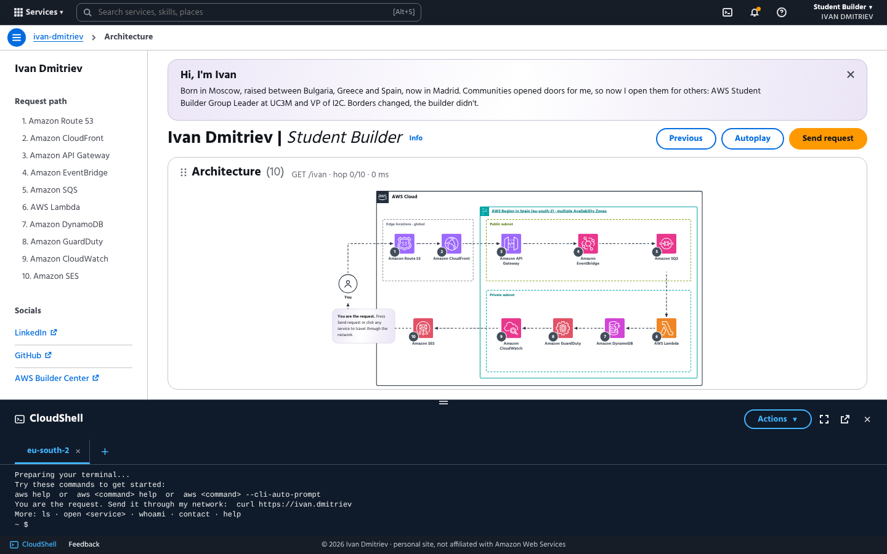

# You are the request

Personal site of **Ivan Dmitriev**, AWS Student Builder Group Leader at UC3M (Colmenarejo) and VP of I2C.
Built for the **AWS Student Builder Challenge: Build Your Tech Superpower**.



## The idea

You don't scroll through a portfolio here. **You are an HTTP request** travelling through my AWS architecture.
Every service on the diagram holds one part of my story, and opening it shows a console-style window:

| # | Service | What's inside |
|---|---------|---------------|
| 1 | Amazon Route 53 | Who I am: Moscow → Bulgaria → Greece → Spain |
| 2 | Amazon CloudFront | UC3M, where I study BBA + Computer Science |
| 3 | Amazon API Gateway | AWS Student Builder Group UC3M, which I founded |
| 4 | Amazon EventBridge | I2C, the CS association I'm VP of |
| 5 | Amazon SQS | Student representation (RITSI, UC3M Delegation) |
| 6 | AWS Lambda | **Tech superpowers** (skills as Lambda layers) and things I built |
| 7 | Amazon DynamoDB | Latest certifications |
| 8 | Amazon GuardDuty | Security training on TryHackMe |
| 9 | Amazon CloudWatch | Operations internship at MAPFRE |
| 10 | Amazon SES | Get in touch |

Personal things live at the global edge, communities in the public subnet, technical work in the private subnet.

### Creative feature: a working CloudShell

The bottom panel is a terminal. Try:

```
curl https://ivan.dmitriev   # send the request through every service (real API call)
ls                           # list the services
cat route53                  # read a service as text
open i2c                     # fly to a service
whoami · contact · help · clear
```

It has tabs (the `+` menu opens new ones, also in other Regions), full screen, a resizable height and command history (↑ ↓).

## Architecture (this is real)

```
Browser ──► AWS Amplify Hosting (static site: site/)
   │
   └─ curl ──► Amazon API Gateway (HTTP API, POST /request)
                   └─► AWS Lambda (Python 3.12, arm64)
                           └─► Amazon DynamoDB (visit counter)
```

When you run `curl` in the CloudShell, the site really calls API Gateway → Lambda → DynamoDB in
**eu-south-2 (Spain)** and prints the real round-trip time, the Lambda request id and your visitor number.
If the API isn't configured, the site still works in demo mode.

| Path | What it is |
|------|------------|
| `site/` | The static site (HTML + vanilla JS with Preact/htm vendored, no build step) |
| `amplify.yml` | Amplify Hosting build settings (serves `site/`) |
| `template.yaml` | AWS SAM template: HTTP API, Lambda, DynamoDB table |
| `backend/request/app.py` | The Lambda handler |
| `scripts/deploy-api.sh` | Deploys the API and writes its URL into `site/config.js` |

## Deploy it yourself

**1. API (SAM)**

```bash
AWS_PROFILE=<your-profile> ./scripts/deploy-api.sh
git add site/config.js && git commit -m "Point site at live API" && git push
```

**2. Site (Amplify Hosting)**

In the Amplify console: *Create new app → GitHub →* this repo, branch `main`. Amplify picks up `amplify.yml`
and serves `site/`. Every push redeploys.

**3. Lock the API to the site's origin**

```bash
ALLOWED_ORIGIN=https://main.<app-id>.amplifyapp.com ./scripts/deploy-api.sh
```

## Run locally

```bash
cd site && python3 -m http.server 8000
# open http://localhost:8000
```

---

Personal site, not affiliated with Amazon Web Services. AWS service icons from the official AWS Architecture Icons.
